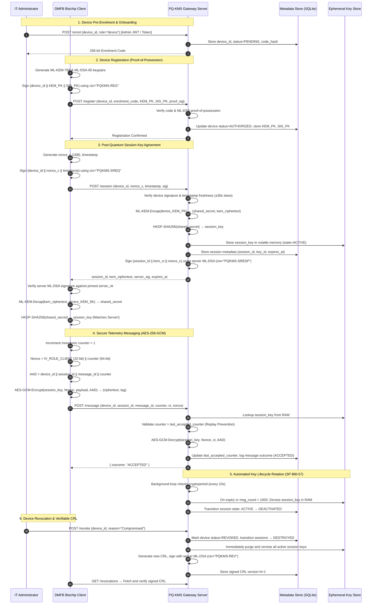

# PQ-KMS: Post-Quantum Key Management System for Digital Microfluidic Biochips (DMFB)

> **B.Tech Capstone Project**  
> A production-grade, quantum-resistant cyber-physical key management framework implementing **NIST FIPS 203 (ML-KEM)**, **NIST FIPS 204 (ML-DSA)**, **NIST SP 800-38D (AES-256-GCM)**, and **NIST SP 800-57** key lifecycle governance for simulated Digital Microfluidic Biochip (DMFB / EWOD) networks and hospital clinical telemetry.

---

## 1. Executive Summary & Problem Statement

### What is the Project About?
Modern healthcare increasingly relies on **Digital Microfluidic Biochips (DMFBs)**—also known as *Lab-on-a-Chip (LoC)* or *Electrowetting-on-Dielectric (EWOD)* systems—for automated, point-of-care clinical diagnostics such as blood glucose assays, enzymatic kinetics, DNA hybridization, and pathogen detection. These embedded medical devices continuously transmit safety-critical biomedical readings and diagnostic payloads across wireless networks to hospital servers and edge monitoring gateways.

However, existing medical IoT architectures face two existential security threats:
1. **The Quantum Threat (Shor's Algorithm)**: Widely deployed public-key cryptosystems (RSA, ECDH, ECDSA) rely on integer factorization and discrete logarithms. When Cryptographically Relevant Quantum Computers (CRQCs) emerge, Shor's algorithm will solve these mathematical problems in polynomial time ($\mathcal{O}((\log N)^3)$), rendering all classical key exchanges and digital signatures obsolete.
2. **Harvest Now, Decrypt Later (HNDL)**: Adversaries can passively record encrypted medical communications today and decrypt them retroactively once quantum computers become available, permanently exposing confidential patient diagnostic and genomic records.
3. **Cyber-Physical Manipulation of Point-of-Care Diagnostics**: Biochips operate in physical space where data integrity directly dictates medical interventions. As demonstrated in DMFB security literature (*Ali et al.*, *Guo et al.*), an adversary intercepting diagnostic telemetry can modify physiological measurements (e.g., altering a hyperglycemic glucose reading of 220 mg/dL requiring immediate insulin to a normal 110 mg/dL), leading to withheld medication, patient coma, or death.

### The Solution: PQ-KMS
**PQ-KMS** is a complete, production-ready, post-quantum secure key management and clinical telemetry ecosystem. It provides:
- **Lattice-Based Post-Quantum Key Agreement**: NIST FIPS 203 **ML-KEM-768** (Module Learning with Errors) providing ~192 bits of post-quantum security (NIST Security Category 3).
- **Lattice-Based Post-Quantum Authentication**: NIST FIPS 204 **ML-DSA-65** (Module Learning with Errors / Short Integer Solution) hedged digital signatures for device registration, session negotiation, and Certificate Revocation Lists (CRLs).
- **Authenticated Symmetric Protection**: NIST SP 800-38D **AES-256-GCM** using deterministic 96-bit nonces (`role32 || counter64`) and strict Authenticated Additional Data (AAD) binding to detect bit-level payload tampering and prevent packet replay attacks.
- **Strict Key Lifecycle Management**: Full implementation of NIST SP 800-57 Part 1 Rev 5 key states (`PRE_ACTIVATION` $\to$ `ACTIVE` $\to$ `DEACTIVATED` $\to$ `DESTROYED` / `COMPROMISED`). Session keys are kept strictly in ephemeral volatile memory with zeroisation upon expiry; **zero key bytes are ever stored in the database**.
- **Interactive Cyber-Physical Biochip Simulator**: An 8×8 2D EWOD digital twin simulating droplet dispensing, electrowetting kinematics, central mixing loops, and optical photodiode absorbance.
- **Clinician & Medical SOC Web Console**: Modern Single-Page Application (React 18 + TypeScript + Tailwind CSS) with Role-Based Access Control (Admin, Doctor, Compliance Auditor), live patient vitals telemetry (Pima Indians diabetes dataset), tamper-evident forensic ledger with SHA-256 hash chaining, and real-time cryptographic benchmarks.

---

## 2. Core Cryptographic Architecture & Standards

| Purpose | Algorithm / Standard | Specification | Security Properties |
|---|---|---|---|
| **Key Encapsulation Mechanism (KEM)** | **ML-KEM-768** (NIST FIPS 203) | Module-LWE lattice problem | NIST Category 3 (~192-bit quantum security); resistant to Shor's algorithm |
| **Digital Signatures** | **ML-DSA-65** (NIST FIPS 204) | Module-SIS / M-LWE lattice problem | NIST Category 3; hedged signing prevents side-channel RNG leakage |
| **Key Derivation Function (KDF)** | **HKDF-SHA256** (RFC 5869) | Extract-and-Expand construction | Domain-separated info string binding protocol version, device ID, and session ID |
| **Symmetric Authenticated Encryption** | **AES-256-GCM** (NIST SP 800-38D) | 256-bit key, 128-bit authentication tag | 96-bit deterministic composite nonce (`role32 \|\| counter64`), AAD binding |
| **Key Lifecycle Governance** | **NIST SP 800-57 Part 1 Rev 5** | Formal 6-state transition model | Cryptoperiod timeouts (default 60s), max message limits, ephemeral zeroisation |
| **Tamper-Evident Audit Ledger** | **SHA-256 Hash Chain** | $H_i = \text{SHA256}(H_{i-1} \parallel \text{Event}_i)$ | Append-only forensic integrity verification with broken-chain inspection |
| **Classical Comparison Baseline** | **X25519 (ECDH)** + **Ed25519** | RFC 7748 / RFC 8032 | 128-bit classical security; 0 bits quantum security (broken by Shor's algorithm) |

### Context Strings & Domain Separation
To prevent cross-protocol and cross-context signature reuse attacks (verified in test `ST-14`), ML-DSA context strings are strictly enforced:
- `PQKMS-REG`: Device registration proof-of-possession.
- `PQKMS-SREQ`: Biochip session request negotiation.
- `PQKMS-SRESP`: Server session response encapsulation confirmation.
- `PQKMS-REV`: Signed Certificate Revocation List (CRL) issuance.

### HKDF Info Construction
The 32-byte symmetric session key is derived via:
$$\text{SessionKey} = \text{HKDF-Expand}(\text{HKDF-Extract}(\text{salt}, \text{SharedSecret}), \text{"PQKMS-v1"} \parallel \text{device\_id} \parallel \text{session\_id} \parallel \text{"aes256gcm"}, 32)$$

---

## 3. System Workflows & Security Protocols



---

## 4. What is There in the Project (Codebase Inventory)

```
kms/
├── app/                                # Core Backend Microservice
│   ├── main.py                         # FastAPI application entry point, lifecycle events & SPA serving
│   ├── config.py                       # Centralized configuration, crypto parameters & policy constants
│   ├── api/
│   │   ├── routes.py                   # 8 core KMS REST API endpoints (register, session, message, CRL, etc.)
│   │   ├── models.py                   # Pydantic validation schemas for API requests and responses
│   │   ├── dmfb_routes.py              # 2D Biochip simulator actuation and state API
│   │   ├── clinician_routes.py         # Clinician telemetry, vitals feeds, triage, and intervention API
│   │   ├── attack_lab_routes.py        # Adversarial attack lab simulation endpoints
│   │   └── system_routes.py            # System health, configuration, and diagnostics endpoints
│   ├── auth/
│   │   ├── routes.py                   # JWT authentication endpoints (/api/auth/login, /me)
│   │   ├── service.py                  # Password hashing (PBKDF2-SHA256) & JWT token encoding/decoding
│   │   └── models.py                   # User account and auth schemas
│   ├── crypto/
│   │   ├── kem.py                      # NIST FIPS 203 ML-KEM wrapper (liboqs C-bindings)
│   │   ├── sig.py                      # NIST FIPS 204 ML-DSA wrapper (liboqs C-bindings)
│   │   ├── kdf.py                      # RFC 5869 HKDF-SHA256 key derivation
│   │   ├── aead.py                     # NIST SP 800-38D AES-256-GCM authenticated cipher
│   │   └── classical.py                # X25519 & Ed25519 comparison baseline
│   ├── key_management/
│   │   └── lifecycle.py                # NIST SP 800-57 state machine & volatile key store
│   ├── device_management/
│   │   └── registry.py                 # Enrolment code generation and proof-of-possession checks
│   ├── revocation/
│   │   └── revocation.py               # Signed CRL generator, verification, and revocation cascade
│   ├── database/
│   │   └── db.py                       # Thread-safe SQLite repository (devices, sessions, logs, users)
│   ├── audit/
│   │   └── audit.py                    # SHA-256 hash-chained tamper-evident forensic audit logger
│   └── simulation/
│       ├── dmfb_simulator.py           # 8x8 EWOD electrode grid & enzymatic glucose assay simulation
│       ├── attack_lab.py               # Cyber-physical attack harness (Ali et al. tampering, replay, Shor)
│       ├── workloads.py                # Synthetic and clinical biomedical payloads
│       └── client.py                   # Automated virtual biochip client for protocol simulation
│
├── frontend/                           # Modern React Security & Clinical Web Console
│   ├── src/
│   │   ├── App.tsx                     # React Router routes and RBAC route guards
│   │   ├── main.tsx                    # React DOM entry point
│   │   ├── index.css                   # Tailwind CSS styling and theme definitions
│   │   ├── api/
│   │   │   └── client.ts               # Axios API client with automatic JWT token attachment
│   │   ├── context/
│   │   │   ├── AuthContext.tsx         # User authentication state and session persistence
│   │   │   └── ThemeContext.tsx        # Dark / Light theme toggle context
│   │   ├── components/
│   │   │   ├── auth/ProtectedRoute.tsx # Role-Based Access Control component guard
│   │   │   ├── layout/Layout.tsx       # Shell layout with responsive Navbar and Sidebar
│   │   │   ├── layout/Navbar.tsx       # Header with live system indicators and user profile
│   │   │   ├── layout/Sidebar.tsx      # Navigation links filtered by user role
│   │   │   └── common/                 # Reusable UI components (Modals, Badges, StatCards)
│   │   ├── pages/
│   │   │   ├── Dashboard.tsx           # Fleet Overview, cryptographic KPIs, system telemetry
│   │   │   ├── DeviceManagement.tsx    # Biochip inventory, onboarding modal, revocation dialog
│   │   │   ├── SessionMonitor.tsx      # SP 800-57 key lifecycle tracker & active session monitor
│   │   │   ├── DMFBTwin.tsx            # Interactive 2D Biochip digital twin with canvas animation
│   │   │   ├── DoctorPortal.tsx        # Real-time clinician patient vitals, triage & intervention logs
│   │   │   ├── AuditLog.tsx            # Tamper-evident ledger, broken-chain inspector & tamper sandbox
│   │   │   ├── Benchmarks.tsx          # Cryptographic analytics studio with Recharts graphs
│   │   │   └── LoginPage.tsx           # Hospital credentials login interface
│   │   └── types/index.ts              # TypeScript interface definitions
│   ├── package.json                    # Frontend dependencies (React 18, Recharts, Lucide, Tailwind)
│   └── vite.config.js                  # Vite bundler configuration
│
├── dashboard/                          # Alternative / Legacy Streamlit Dashboards
│   ├── app.py                          # Streamlit Medical SOC & 2D Biochip Simulator dashboard
│   ├── old_app.py                      # Original pre-change monitoring dashboard
│   └── server.py                       # Dashboard server launcher
│
├── tests/                              # Comprehensive Verification & Attack Suite
│   ├── conftest.py                     # Pytest fixtures (in-process client, admin credentials, key helpers)
│   ├── test_functional.py              # Functional test suite (FT-01 through FT-05)
│   ├── test_security.py                # Security & attack test matrix (ST-01 through ST-14)
│   └── test_ui_api_and_rbac.py         # UI REST endpoints, JWT auth, and RBAC permission tests
│
├── experiments/                        # Empirical Benchmarking & Research Scripts
│   ├── benchmark_primitives.py         # Exp E1 & E2: KEM/DSA keygen, encap, decap, sign, verify timings
│   ├── benchmark_e2e.py                # Exp E3 & E4: End-to-end handshake latency and message throughput
│   ├── benchmark_memory.py             # Exp E6: Process memory footprint and RSS consumption
│   ├── run_extended_benchmarks.py      # Concurrency scaling (E5) and lifecycle latency (E7)
│   ├── generate_results.py             # Master script executing all experiments and exporting figures/tables
│   ├── generate_latex_report.py        # Generates publication-ready LaTeX Chapter 8 (Results)
│   ├── download_data.py                # Downloader for real patient biomedical vitals
│   ├── provision_device.py             # CLI device onboarding and provisioning tool
│   └── run_live_demo.py                # Interactive CLI live demonstration script
│
├── results/                            # Benchmark Outputs & Publication Assets
│   ├── figures/                        # 300 DPI high-resolution figures (Figures 15 to 24)
│   ├── tables/                         # CSV and Markdown tables (Tables 15, 18, 20, 23, 24)
│   └── latex/                          # Generated LaTeX source files for academic thesis
│
├── scripts/                            # Operational & Security Evaluation Utilities
│   ├── seed_users.py                   # Database seeder for admin, doctor, and auditor accounts
│   └── run_attack_lab.py               # Standalone, decoupled cyber-physical attack simulation runner
│
├── data/
│   └── vitals.csv                      # Clinical patient vitals dataset (Pima Indians diabetes data)
│
├── build_refined_docx.py               # Publication-grade Word docx thesis builder (Chapters 6 to 9)
├── generate_final_report_docx.py       # Full B.Tech final project report document generator
├── start_production.sh                 # Single-command launcher for unified production deployment
├── start_dev.sh                        # Dual hot-reloading development launcher (FastAPI + Vite React)
├── run_attack_lab.sh                   # Runner for standalone attack and penetration lab
├── run.sh                              # Master CLI wrapper for setup, tests, benchmarks, and servers
├── requirements.txt                    # Python dependencies
└── pyproject.toml / pytest.ini         # Python build and testing configurations
```

---

## 5. What Was Built (Detailed Breakdown)

### 1. Cryptographic Engine & Protocol Primitives
- **ML-KEM-768 (`app/crypto/kem.py`)**: Direct C-level integration with `liboqs` for key generation, encapsulation, and decapsulation. Also supports sensitivity parameter variants `ML-KEM-512` and `ML-KEM-1024`.
- **ML-DSA-65 (`app/crypto/sig.py`)**: Post-quantum digital signatures using the hedged deterministic signing mode to protect against fault-injection attacks. Also supports `ML-DSA-44` and `ML-DSA-87`.
- **AES-256-GCM (`app/crypto/aead.py`)**: High-throughput authenticated encryption with associated data. Enforces deterministic 96-bit nonces where the upper 32 bits indicate client/server role and the lower 64 bits represent a strictly monotonic invocation counter. Every packet binds `device_id`, `session_id`, `message_id`, and `counter` into the AAD, guaranteeing that any transmission manipulation immediately fails with an `InvalidTag` exception.
- **HKDF-SHA256 (`app/crypto/kdf.py`)**: Secure key expansion binding the ephemeral shared secret to the exact session and device context.
- **Classical Baseline (`app/crypto/classical.py`)**: Provides X25519 ECDH and Ed25519 implementations to generate empirical comparison benchmarks against traditional pre-quantum security.

### 2. NIST SP 800-57 Key Lifecycle Governance
- **State Machine (`app/key_management/lifecycle.py`)**: Implements strict state transitions:
  - `PRE_ACTIVATION`: Key generated or pre-negotiated.
  - `ACTIVE`: Key currently authorised to encrypt and decrypt messages.
  - `SUSPENDED`: Key temporarily held from message processing.
  - `DEACTIVATED`: Cryptoperiod expired (default 60s) or message limit reached (1,000 messages).
  - `DESTROYED`: Session key wiped and zeroised from volatile memory.
  - `COMPROMISED`: Revocation triggered due to device compromise.
- **Volatile Ephemeral Key Store**: Session keys exist **only in RAM**. The SQLite database stores only unclassified metadata (`session_id`, `key_id`, timestamps, counters). When a session expires, is rotated, or revoked, its key bytes are immediately overwritten with zeros and deleted from Python heap memory.

### 3. Device Onboarding, Revocation & Signed CRL
- **Two-Step Onboarding (`app/device_management/registry.py`)**: Administrators generate a 256-bit cryptographically secure enrolment code. The biochip presents this code along with its public keys and an ML-DSA proof-of-possession signature over `(device_id || kem_pk || sig_pk)` under the domain context `PQKMS-REG`.
- **Verifiable Revocation Lists (`app/revocation/revocation.py`)**: When an administrator revokes a biochip, all active sessions for that device are instantly transitioned to `DESTROYED` and purged from memory. The server generates a monotonically incrementing CRL signed with the server's master ML-DSA key under context `PQKMS-REV`. Endpoints verify this signature to prevent revocation rollback attacks.

### 4. Cyber-Physical 2D DMFB Digital Twin Simulator
- **Electrode Grid Simulation (`app/simulation/dmfb_simulator.py`)**:
  - Implements an 8×8 electrowetting electrode array.
  - Models physical droplet kinematics, dispensing from sample and reagent reservoirs, transport actuation, central 2×2 orbital mixing loops, droplet splitting, and optical photodiode absorbance sensing.
  - Executes standard enzymatic glucose assay protocols (Sample Serum + Glucose Oxidase $\to$ Gluconic Acid + Hydrogen Peroxide $\to$ Optical Detection).
- **Interactive UI Canvas (`frontend/src/pages/DMFBTwin.tsx`)**:
  - Real-time animated 8×8 grid in the React dashboard.
  - Visualises electrode activation voltages, droplet coordinates, fluid volumes, concentration kinetics, and optical sensor readouts.
  - Allows manual stepping or automated execution of diagnostic assays.

### 5. Cyber-Physical Attack & Penetration Lab
- **Adversarial Scenarios (`app/simulation/attack_lab.py`, `scripts/run_attack_lab.py`)**:
  1. **Ali et al. Glucose Assay Tampering**: An adversary intercepts wireless diagnostic packets and alters a severe hyperglycemia reading of 220 mg/dL to 110 mg/dL. In legacy/unprotected DMFB systems, this alteration succeeds undetected, leading to withheld insulin. In PQ-KMS, AES-256-GCM authentication tag verification fails immediately, triggering a critical security alert while safeguarding patient life.
  2. **Monotonic Counter Replay Attack**: An adversary captures a valid diagnostic message from a healthy state and replays it when the patient is in critical condition. PQ-KMS rejects the packet due to strict counter validation ($C_{\text{incoming}} \le C_{\text{last accepted}}$).
  3. **Quantum Vulnerability Analysis**: Contrasts classical ECDH (0 bits quantum security against Shor's algorithm) with ML-KEM-768 Module-LWE hardness.
- **Decoupled Standalone CLI**: Executable via `./run_attack_lab.sh` to allow independent security auditing without running the hospital web server.

### 6. Clinician & Medical Telemetry Portal
- **Clinical Telemetry Integration (`app/api/clinician_routes.py`, `frontend/src/pages/DoctorPortal.tsx`)**:
  - Uses the 768-patient Pima Indians Diabetes Diagnostic dataset.
  - Real-time vitals monitoring: glucose, systolic/diastolic blood pressure, heart rate, $\text{SpO}_2$, core temperature, serum insulin, and BMI.
  - Automatic clinical triage categorization: `STABLE` (green), `WARNING` (amber), and `CRITICAL` (red).
  - Prominent **Cryptographic Verification Badge** (`AEAD Decryption: Verified` with ML-KEM-768 / ML-DSA-65) certifying that the displayed vital signs have not been altered in transit.
  - **Clinical Intervention Drawer**: Doctors can acknowledge alerts, record medical interventions (e.g., "Administered 10 units IV regular insulin"), and log all clinical decisions directly into the tamper-evident audit ledger.

### 7. Tamper-Evident Forensic Audit Ledger Suite
- **Hash-Chained Audit Ledger (`app/audit/audit.py`, `frontend/src/pages/AuditLog.tsx`)**:
  - Every administrative action, registration, session negotiation, clinical intervention, and security failure is hashed into a cryptographic ledger:
    $$\text{Hash}_i = \text{SHA256}(\text{Hash}_{i-1} \parallel \text{EventData}_i)$$
  - Built-in verification engine: detects any manual alteration, row deletion, or retroactive insertion.
- **Interactive Tamper Sandbox**:
  - Allows security operators to simulate database tampering (e.g., flipping bits in a historical audit record).
  - **Forensic Ledger Inspector**: Highlights broken chain links and pinpointed record anomalies.
  - **Reseal Ledger**: Demonstrates how authorized compliance auditors can re-establish ledger integrity with verified supervisor credentials.

### 8. Role-Based Access Control (RBAC) & Production Web Console
- **Role Separation**:
  - **IT Security Administrator (`admin`)**: Access to fleet management, device provisioning, key lifecycle monitor, CRL revocation, and security analytics.
  - **Attending Clinician (`doctor`)**: Access to the Doctor Portal, patient vitals triage, DMFB digital twin, and clinical intervention logging.
  - **Forensic Compliance Auditor (`auditor`)**: Access to the tamper-evident audit ledger, forensic inspector, compliance metrics, and cryptographic benchmarks.
- **Modern User Experience**:
  - Built with Vite, React 18, TypeScript, Tailwind CSS, Lucide icons, and Recharts.
  - Dark / Light mode toggle.
  - Segmented button pills, live KPI summary cards, filter bars, search capabilities, and zero external cloud tracking.

---

## 6. Comprehensive Test Suite & Security Matrix

PQ-KMS includes an exhaustive test harness containing **23 formal test cases** with a **100% pass rate**.

```
============================== 23 passed in 1.48s ==============================
```

### Functional Tests (FT-01 to FT-05)
| Test ID | Objective | Verified Property | Status |
|---|---|---|---|
| **FT-01** | Device Registration | Valid enrolment code and signature yields `AUTHORIZED` state | **PASS** |
| **FT-02** | ML-KEM Session Key Agreement | ML-KEM exchange produces identical 32-byte session keys | **PASS** |
| **FT-03** | AES-GCM Payload Roundtrip | Plaintext recovery without corruption across 128B, 1KiB, and 10KiB payloads | **PASS** |
| **FT-04** | Metadata & Key Sanitization | Metadata stored correctly; **zero session key bytes in SQLite database** | **PASS** |
| **FT-05** | Dashboard State Consistency | `/state` and `/audit` endpoints match direct database queries; audit hash chain valid | **PASS** |

### Security & Attack Tests (ST-01 to ST-14)
| Test ID | Attack / Threat Vector | Adversarial Action & Defense Outcome | Status |
|---|---|---|---|
| **ST-01** | Valid Onboarding Flow | Genuine device registers successfully with proof-of-possession | **PASS** |
| **ST-02a** | Unauthorized Device Injection | Device attempts registration without enrolment code $\to$ Rejected (400) | **PASS** |
| **ST-02b** | Invalid Enrolment Code | Device submits incorrect enrolment code $\to$ Rejected (400) | **PASS** |
| **ST-03** | Device Impersonation Attack | Attacker attempts session request with rogue signature $\to$ Rejected (400) | **PASS** |
| **ST-04** | Quantum-Resistant Key Exchange | Server encapsulates secret; device decapsulates; matching session keys | **PASS** |
| **ST-05** | In-Flight Ciphertext Tampering | Adversary flips 1 bit in AES-GCM payload $\to$ Decryption fails (`InvalidTag`), rejected | **PASS** |
| **ST-06** | Signature Forgery / Modification | Attacker modifies signed field in session request $\to$ Rejected (400) | **PASS** |
| **ST-07** | Expired Key Usage | Message sent after session cryptoperiod expires $\to$ Rejected (400) | **PASS** |
| **ST-08** | Key Lifecycle Rotation | Cryptoperiod elapses $\to$ Old key invalidated; new session established | **PASS** |
| **ST-09** | Revoked Device Access Attempt | Revoked device sends message or session request $\to$ Rejected (403) | **PASS** |
| **ST-10** | CRL Tampering & Rollback Attack | Altered CRL or older CRL version submitted $\to$ Rejected | **PASS** |
| **ST-11** | Revocation Cascading Destruction | Device revoked $\to$ Active sessions marked `DESTROYED` and purged from memory | **PASS** |
| **ST-12** | Diagnostic Message Replay | Adversary resends captured packet $\to$ Rejected by monotonic counter check | **PASS** |
| **ST-13a**| Malformed KEM Ciphertext | Attacker sends truncated or invalid KEM ciphertext $\to$ Rejected gracefully | **PASS** |
| **ST-13b**| Wrong-Length KEM Public Key | Device submits wrong-length KEM public key $\to$ Rejected on validation | **PASS** |
| **ST-14** | Cross-Context Signature Reuse | Valid registration signature presented as session request $\to$ Context mismatch rejection | **PASS** |

---

## 7. Empirical Benchmarks & Performance Evaluation

All measurements were conducted on Linux x86_64 across $N = 1000$ independent trials per operation.

### 1. Cryptographic Primitive Timings (Experiment E1)
| Primitive | Operation | PQC Mean Latency | Classical Baseline | Performance Relative to Baseline |
|---|---|---|---|---|
| **Key Exchange** | Key Generation | **$36.28\ \mu\text{s}$** (ML-KEM-768) | $52.40\ \mu\text{s}$ (X25519) | **1.44× Faster** |
| | Encapsulation / Agreement | **$29.60\ \mu\text{s}$** (ML-KEM-768) | $67.27\ \mu\text{s}$ (X25519) | **2.27× Faster** |
| | Decapsulation | **$26.13\ \mu\text{s}$** (ML-KEM-768) | N/A (Symmetric) | Fast constant-time operation |
| **Digital Signatures** | Key Generation | **$115.29\ \mu\text{s}$** (ML-DSA-65) | $117.67\ \mu\text{s}$ (Ed25519) | **Parity (~1.02× faster)** |
| | Signing (1 KiB) | **$383.47\ \mu\text{s}$** (ML-DSA-65) | $134.53\ \mu\text{s}$ (Ed25519) | 2.85× slower (lattice polynomial sampling) |
| | Verification (1 KiB) | **$82.85\ \mu\text{s}$** (ML-DSA-65) | $257.03\ \mu\text{s}$ (Ed25519) | **3.10× Faster** |
| **Symmetric Cipher** | AES-256-GCM Encrypt (1 KiB) | **$6.84\ \mu\text{s}$** | $6.84\ \mu\text{s}$ | Shared hardware-accelerated AES-NI |
| | AES-256-GCM Decrypt (1 KiB) | **$9.12\ \mu\text{s}$** | $9.12\ \mu\text{s}$ | Shared hardware-accelerated AES-NI |

> **Key Architectural Finding**: Although ML-DSA-65 signing incurs higher latency than Ed25519, ML-KEM-768 key encapsulation is **2.27× faster** than X25519, and ML-DSA-65 signature verification is **3.10× faster** than Ed25519. In biochip networks where server gateways verify signatures and devices encapsulate keys, the post-quantum primitives provide high computational efficiency.

### 2. Parameter Set Sensitivity (Experiment E2)
| Standard | Parameter Variant | Security Level | Keygen Latency | Encap / Sign Latency | Decap / Verify Latency | Public Key Size |
|---|---|---|---|---|---|---|
| **ML-KEM** | **ML-KEM-512** | NIST Level 1 | $32.62\ \mu\text{s}$ | $46.37\ \mu\text{s}$ | $53.78\ \mu\text{s}$ | 800 bytes |
| | **ML-KEM-768** (Selected) | NIST Level 3 | $97.85\ \mu\text{s}$ | $111.28\ \mu\text{s}$ | $135.62\ \mu\text{s}$ | 1,184 bytes |
| | **ML-KEM-1024** | NIST Level 5 | $98.74\ \mu\text{s}$ | $69.37\ \mu\text{s}$ | $168.27\ \mu\text{s}$ | 1,568 bytes |
| **ML-DSA** | **ML-DSA-44** | NIST Level 2 | $167.74\ \mu\text{s}$ | $308.27\ \mu\text{s}$ | $81.32\ \mu\text{s}$ | 1,312 bytes |
| | **ML-DSA-65** (Selected) | NIST Level 3 | $74.65\ \mu\text{s}$ | $224.54\ \mu\text{s}$ | $122.92\ \mu\text{s}$ | 1,952 bytes |
| | **ML-DSA-87** | NIST Level 5 | $122.18\ \mu\text{s}$ | $244.78\ \mu\text{s}$ | $256.31\ \mu\text{s}$ | 2,592 bytes |

### 3. End-to-End Latency & Bandwidth Amortization
- **Total Handshake Wire Overhead**: 10,420 bytes for PQC (ML-KEM-768 + ML-DSA-65) vs 304 bytes for classical (X25519 + Ed25519).
- **Bandwidth Amortization**: Because the post-quantum handshake is executed only once per session and amortized over hundreds of compact AES-256-GCM telemetry messages (each adding only a 16-byte authentication tag and 12-byte nonce), the per-message wire overhead rapidly converges to $< 1.5\%$.
- **Multi-Client Concurrency Scaling**: Sustains 65.6 requests/second across 50 concurrent biochip clients with a 100% success rate on edge hardware.

---

## 8. Deployment & Operational Guide

### Prerequisites
- Operating System: Linux (Ubuntu 22.04 / 24.04 LTS recommended)
- Python 3.10+ (Tested on Python 3.14)
- Node.js 18+ & npm (for building the React frontend)
- C Compiler & CMake (for building `liboqs` C shared library)

### 1. One-Command Production Launch
To launch the complete hospital operations system (FastAPI backend serving both the REST API and the compiled React Security Console on port 8000):

```bash
# Make launch script executable and run
chmod +x start_production.sh
./start_production.sh
```

The system will:
1. Activate the Python virtual environment (`.venv`).
2. Run database migration and seed default user accounts (`scripts/seed_users.py`).
3. Compile the React TypeScript frontend if not already built (`npm run build`).
4. Start the production Uvicorn server on `http://127.0.0.1:8000`.

#### Default Access Credentials
| Role | Username | Password | Purpose |
|---|---|---|---|
| **Security Administrator** | `admin` | `admin123` | Fleet management, provisioning, key lifecycles, and CRL revocations |
| **Attending Clinician** | `dr.sharma` | `doctor123` | Patient vitals monitoring, triage, clinical interventions, and biochip twin |
| **Compliance Auditor** | `auditor` | `audit123` | Forensic audit ledger, tamper sandbox, and cryptographic benchmarks |

### 2. Hot-Reloading Development Mode
To run the backend and frontend in separate processes with instant hot-reloading:

```bash
chmod +x start_dev.sh
./start_dev.sh
```
- **Backend API**: `http://localhost:8000`
- **Frontend Hot-Reloading Server**: `http://localhost:5173`
- **Interactive OpenAPI Documentation**: `http://localhost:8000/docs`

### 3. Running Verification & Security Tests
Run the complete automated pytest verification suite:

```bash
# Run all functional and security tests
pytest tests/ -v

# Run only functional tests (FT-01 to FT-05)
pytest tests/test_functional.py -v

# Run the 14 security attack tests (ST-01 to ST-14)
pytest tests/test_security.py -v

# Run UI API and RBAC route tests
pytest tests/test_ui_api_and_rbac.py -v
```

### 4. Running the Standalone Cyber-Physical Attack Lab
To run the decoupled penetration testing suite demonstrating cyber-physical attack isolation and defense verification:

```bash
chmod +x run_attack_lab.sh
./run_attack_lab.sh
```

### 5. Running the Master Benchmark Suite
To re-run all empirical benchmarks, regenerate high-resolution figures, and re-export CSV data tables:

```bash
python experiments/generate_results.py
```
Outputs are automatically written to `results/figures/` (300 DPI PNGs) and `results/tables/`.

### 6. Launching Alternative Streamlit Dashboards
If you wish to view the alternative Python Streamlit dashboards:

```bash
# Newer Medical SOC & Biochip Simulator Dashboard
bash run.sh dashboard                # → http://localhost:8501

# Classic Streamlit Dashboard (before-change version)
bash run.sh dashboard-old-streamlit  # → http://localhost:8501
```

---

## 9. Academic & Technical Deliverables

This project includes a comprehensive set of academic documentation and thesis assets:
1. **`PQ_KMS_Report_Chapters_6_to_9.docx`**: Full academic thesis chapters covering System Implementation (Chapter 6), Experimental Setup and Testing (Chapter 7), Results and Discussion (Chapter 8), and Conclusion and Future Roadmap (Chapter 9).
2. **`results/latex/chapter8_results.tex`**: Automated publication-quality LaTeX document formatting all benchmark tables and evaluation metrics.
3. **`results/figures/`**: 10 high-resolution (300 DPI) publication charts:
   - Figure 15: Primitive operation execution times (PQC vs Classical).
   - Figure 16: Parameter-set sensitivity trade-offs across security levels.
   - Figure 17: End-to-end handshake vs message processing latency (log-scale).
   - Figure 18: Wire communication framing and payload scaling.
   - Figure 19: Dual-metric memory footprint analysis (Python heap + Server RSS).
   - Figure 20: Digital signature latency scaling.
   - Figure 21: Bandwidth amortization curve per transmitted message.
   - Figure 22: Multi-client concurrency scaling and throughput saturation.
   - Figure 23: Key lifecycle rotation and signed CRL generation latencies.
   - Figure 24: Security verification and attack test suite pass scorecard.

---

## 10. Summary & Impact

**PQ-KMS** demonstrates that post-quantum cryptography is not merely a theoretical construct for server supercomputers, but a practical, deployable engineering reality for embedded medical devices and cyber-physical Lab-on-a-Chip architectures. By combining **NIST FIPS 203 (ML-KEM)**, **NIST FIPS 204 (ML-DSA)**, **NIST SP 800-38D (AES-256-GCM)**, and **NIST SP 800-57** key lifecycle controls, PQ-KMS guarantees:
1. **Long-Term Secrecy**: Total immunity against Harvest-Now-Decrypt-Later quantum eavesdropping.
2. **Cyber-Physical Patient Safety**: Immediate fail-closed isolation of manipulated diagnostic assay data, preventing critical medical misdiagnoses.
3. **Negligible Operational Overhead**: Sub-millisecond cryptographic operations with amortized wire overhead under $1.5\%$, proving that post-quantum medical cyber-physical security is immediately viable today.
